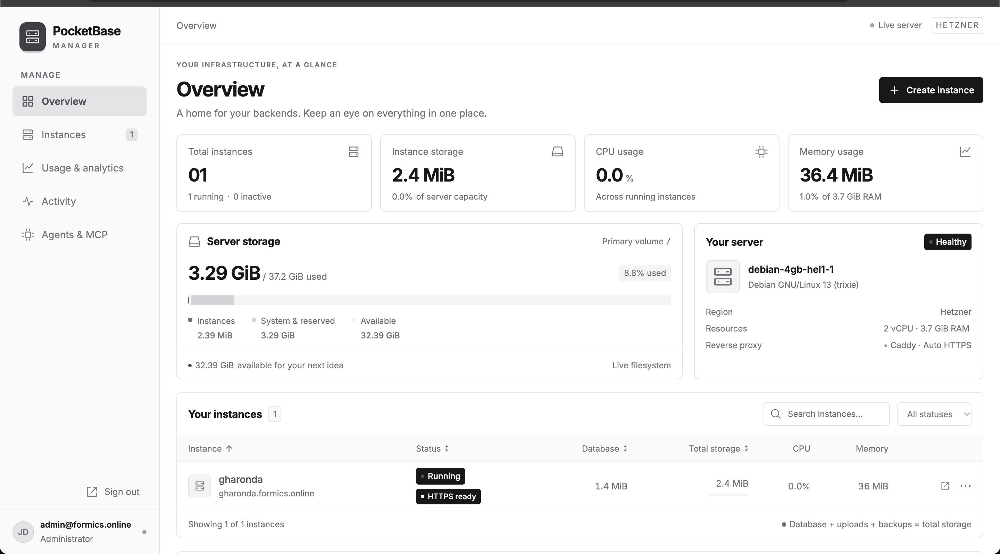

# PocketBase Manager

An admin-only control plane for independent PocketBase instances, built with **Go + PocketBase** and an **Astro + TypeScript** dashboard.

**[Try the interactive demo →](https://jagdishjadeja.github.io/pbmanager/)**

The static demo uses browser-local sample data. Explore the dashboard, create or restart sample instances, and reset it anytime. It does not connect to a live management server.

## Dashboard preview



Manage your PocketBase instances and monitor server resources from one dashboard.

```text
frontend/             Astro dashboard, managed exclusively with pnpm
backend/              Go API, persistent PocketBase metadata, and Linux agent
deployment/hetzner/   systemd units, installer, build script, and real-server smoke test
deployment/github-pages/  builder for the standalone static demo
docs/                 GitHub Pages demo and dashboard screenshot
```

## GitHub Pages demo

The public demo is hosted at **https://jagdishjadeja.github.io/pbmanager/**. It uses the same Astro dashboard with demo mode enabled and packages the styles, JavaScript, and favicon into `docs/index.html`.

To rebuild it after changing the frontend, install frontend dependencies and run from the repository root:

```sh
pnpm --dir frontend install --frozen-lockfile
python3 deployment/github-pages/build.py
```

Commit the updated `docs/index.html` and `docs/.nojekyll`. GitHub Pages publishes `main` → `/docs` through **Settings → Pages → Deploy from a branch**. The Go backend and root agent are deployed separately on your VPS using the instructions below.

## Deploy on your own VPS

The scripts in `deployment/hetzner/` work on other VPS providers too. The current release targets **Linux amd64/x86_64** with **systemd**. Use an Ubuntu or Debian VM with root access and support for loop-mounted ext4 volumes; an ARM VPS or restricted container needs deployment changes. Keep at least 3 GiB free before creating the first instance: each instance allocates 1 GiB, and the agent keeps 2 GiB free on the host.

The examples below use `example.com`, `pb.example.com`, and `YOUR_SERVER_IP`. Replace them with your domain and VPS IPv4 address.

### 1. Configure DNS and network access

Create these DNS records:

| Type | Name | Value |
| --- | --- | --- |
| A | `pb.example.com` | `YOUR_SERVER_IP` |
| A | `myapp.example.com` | `YOUR_SERVER_IP` |

The first record serves the manager; the second is an example instance named `myapp`. Add an A record for each instance, or optionally use `*.example.com` to cover all instance names. Start with DNS-only records so DNS resolves directly to the VPS. Remove any conflicting AAAA record unless IPv6 also reaches this server.

Allow inbound TCP **80 and 443** in your VPS firewall for Caddy's HTTPS setup and web traffic. Allow SSH on your configured SSH port (22 by default); scoped SFTP accounts also use SSH. The manager's port 8095 and instance ports 21000–29999 listen on loopback and do not need public firewall rules.

### 2. Prepare the VPS

Connect from your computer:

```sh
ssh root@YOUR_SERVER_IP
```

Run on the VPS as root:

```sh
apt-get update
apt-get install -y ca-certificates curl unzip python3 e2fsprogs util-linux passwd procps openssh-server
```

Install Caddy using its [official Debian/Ubuntu package instructions](https://caddyserver.com/docs/install#debian-ubuntu-raspbian), which create the `caddy` user and systemd service. Then create the directory for managed routes:

```sh
install -d -m 0755 /etc/caddy/sites.d
```

Add this line at the **top level** of `/etc/caddy/Caddyfile`, outside any site block. Preserve existing site definitions:

```caddyfile
import /etc/caddy/sites.d/*.caddy
```

Validate and reload Caddy:

```sh
caddy validate --config /etc/caddy/Caddyfile --adapter caddyfile
systemctl enable --now caddy
systemctl reload caddy
```

### 3. Build the release on your computer

Use macOS or Linux with Git, Bash, [Go 1.26+](https://go.dev/doc/install), Node.js 22.23.4+, and [pnpm 12.10.1](https://pnpm.io/installation). Node.js and Go are only required on the build machine. The VPS runs the resulting binaries and static frontend.

```sh
git clone https://github.com/jagdishjadeja/pbmanager.git
cd pbmanager
pnpm --dir frontend install --frozen-lockfile
bash deployment/hetzner/build.sh
```

The build checks the frontend, runs frontend/backend tests, and cross-compiles the manager and root agent for Linux amd64. It writes `/tmp/pbmanager-release.tar.gz`. Set `PBM_RELEASE_DIR` before running the script if you need another output directory.

### 4. Upload and install

Run from the repository root on your computer:

```sh
scp /tmp/pbmanager-release.tar.gz deployment/hetzner/install.sh root@YOUR_SERVER_IP:/var/tmp/
ssh root@YOUR_SERVER_IP 'PBM_BASE_DOMAIN=example.com PBM_MANAGER_HOST=pb.example.com bash /var/tmp/install.sh /var/tmp/pbmanager-release.tar.gz'
```

Set **both domain variables on the first installation**; otherwise the installer uses the original deployment's `formics.online` defaults. Subsequent installs read `/etc/pbmanager/manager.env` and retain its configuration.

The installer downloads the pinned PocketBase binary, verifies its SHA-256 checksum, creates the manager's Linux account, generates an encryption key and initial administrator credentials, and starts `pbmanager` and `pbmanager-agent`. Caddy obtains HTTPS certificates once DNS reaches the VPS.

### 5. Sign in and create your first instance

Read the initial credentials over your private SSH connection:

```sh
ssh root@YOUR_SERVER_IP 'cat /etc/pbmanager/bootstrap.json'
```

Open **`https://pb.example.com`** and sign in with the email and password from that file. Create an instance named `myapp`, point `myapp.example.com` to the VPS if you did not configure a wildcard, and wait for **HTTPS ready** before opening PocketBase. Each instance has its own superadmin credentials, available from **Superadmin login** in the manager.

Keep `/etc/pbmanager/manager.env`, `/etc/pbmanager/bootstrap.json`, and `/var/lib/pbmanager/` private. Preserve the encryption key when backing up or migrating the manager; replacing it makes stored instance credentials unreadable. Runtime credentials, data, and backups do not belong in Git.

### 6. Check services and deploy updates

Run on the VPS:

```sh
systemctl status pbmanager pbmanager-agent caddy --no-pager
curl -fsS http://127.0.0.1:8095/api/health
journalctl -u pbmanager -u pbmanager-agent -u caddy -n 100 --no-pager
```

If HTTPS is pending, check the hostname's A/AAAA records and inbound ports 80/443. If provisioning fails, inspect the agent logs and confirm the VPS permits loop mounts and has enough free storage and RAM.

For application updates, pull the latest code on your build machine, repeat the build/upload steps, and rerun the installer. It preserves manager data, credentials, the encryption key, and unrelated Caddy routes. This process updates the manager and agent; it does not upgrade existing PocketBase instance binaries.

## Current deployment

Dashboard: **https://pb.formics.online**. Instances: **https://<name>.formics.online**.

The manager listens on `127.0.0.1:8095` behind Caddy. The agent uses a permission-restricted Unix socket at `/run/pbmanager-agent/agent.sock`.

Point `A pb.formics.online` to `46.62.175.23` for the dashboard. Add an individual A record for each instance when you are ready, for example `gharonda.formics.online → 46.62.175.23`. A wildcard is optional and is not required. Caddy obtains individual HTTPS certificates; the dashboard shows DNS pending for an instance whose hostname does not yet resolve.

Initial admin credentials are generated on installation and stored in **`/etc/pbmanager/bootstrap.json`**, readable only by root. They are never committed or printed by deployment scripts. The manager uses a separate admin account from each hosted PocketBase instance.

## What works

- Sign in/out with an HttpOnly, Secure, SameSite cookie; no public registration.
- Create an instance with a chosen name, or leave it blank for a random six-character lowercase alphanumeric name.
- Provision a dedicated Linux account, bounded storage volume, systemd service, and Caddy route in a persistent background operation.
- Start, stop, restart, delete, inspect service logs, and open the actual PocketBase dashboard.
- View initial instance superadmin credentials anytime through **Superadmin login**. They remain encrypted until the instance is deleted. Password changes made directly in PocketBase are not reflected here. Credentials consumed before repeat viewing was enabled cannot be recovered.
- Monitor real server capacity, database size, total allocated instance storage, CPU, RAM, HTTP requests, errors, and incoming/outgoing HTTP body traffic.
- Retain usage samples for 30 days. A new deployment starts without historical data.
- Keep the default domain and attach up to five customer-owned domains per instance.
- Persist provisioning, DNS verification, certificate issuance, retry errors, issuer, and expiry in PocketBase. The dashboard refreshes these states automatically.
- Publish a static website at an instance's root URL from a ZIP of built assets or a single HTML file, with PocketBase retained at `/_/` and `/api/`.

Each instance receives a **1 GiB preallocated ext4 volume**, a configurable RAM limit (512 MiB by default), and one CPU equivalent. Filesystem metadata uses part of that volume. Volumes enforce the storage boundary without changing the shared server’s root filesystem. Server used space includes reserved volumes; total instance storage measures blocks actually used inside each mounted directory.

On older Caddy versions that omit byte-read counters, incoming HTTP traffic is estimated from Content-Length and labeled accordingly.

The control plane stores instances, encrypted provisioning payloads, operations, activity, and metrics in its own PocketBase. Generic collection APIs remain locked. A separate root agent accepts fixed operations for validated, registered instance descriptors. The web application runs without root privileges.

File browsing, custom binaries/hooks, scoped non-admin dashboard users, backup management, and version upgrades are future work. Existing unrelated PocketBase services are preserved and are not automatically imported.

## Domains and HTTPS progress

Every instance keeps its default `<name>.formics.online` address. Add a customer domain during creation or from **Domains & HTTPS → Add domain** on its detail page.

For a customer domain such as `api.customer.com`, create an A record pointing to `46.62.175.23` and the TXT record shown by the manager at `_pbmanager.api.customer.com`. The TXT value proves ownership; customer hostnames are never routed before verification. Existing hostnames used by other Caddy sites and the platform namespace are reserved.

The dashboard separates the running service from public URL readiness: **Verify ownership → Waiting for DNS → Configuring proxy → Certificate in progress → HTTPS ready**. Certificate readiness is confirmed by a trusted TLS handshake against Caddy using the exact hostname. A successful Caddy reload alone does not mark HTTPS ready. Errors and scheduled retries remain visible. Certificate state, issuer, expiry, and domain progress are stored in `manager_instances.data.domains`, alongside overall `provisioningStage` and `provisioningMessage`.

Use **Check DNS & HTTPS** after adding DNS records. Background monitoring also checks automatically. Removing a customer domain preserves the default address and instance data.

**Open PocketBase** is enabled automatically once the service is running and its default domain has active HTTPS. Hover over the disabled button to see the current status and what it is waiting for.

## Static websites

Open an instance and use **Static website → Upload site**. Upload a `.zip` containing `index.html` and the site's built assets, or a standalone `.html` file. A ZIP can contain the build contents directly or a single enclosing directory such as `dist/`. Upload limits are 50 MiB compressed, 100 MiB extracted, and 5,000 archive entries. Server-rendered applications must be exported as static files first.

The website loads at `https://<instance>.formics.online/` and on attached customer domains. PocketBase admin and API routes stay at `/_/` and `/api/`. Publishing replaces only the static website. Invalid archives leave the previous site in place; symlinks, hidden files, unsafe paths, and reserved PocketBase paths are rejected. Files are staged on the instance's bounded volume and published by switching its public directory. They count toward the existing storage allowance.

New services explicitly use their own `--publicDir`. An older instance receives this setting and a one-time service restart when its first site is published; later site replacements do not restart PocketBase. **Remove site** removes only managed static files and keeps PocketBase data intact.

## RAM limits

Choose RAM in the creation form or use **RAM allocation → Save RAM limit** on an existing instance. Values start at 128 MiB and use 64 MiB steps. The server caps each instance below physical RAM with 512 MiB left for the system. Limits apply through systemd `MemoryMax` and persist across restarts. Changing a running instance's limit does not restart it; a value below its current usage is rejected. Changing a stopped instance does not start it. These are usage ceilings, not RAM reservations.

## Agent MCP access and tasks

Open **Agents & MCP** to create a named agent token, assigned to all managed instances or one instance. The endpoint is **https://pb.formics.online/mcp**. Tokens grant superadmin read/write access to assigned PocketBase APIs, including collections, records, settings, and superusers. Tokens are displayed once, stored as SHA-256 hashes, and can be revoked immediately. Database requests use a dedicated instance superuser named `pbmanager-mcp@<instance-hostname>`; customer passwords are not changed or disclosed. Agent actions are recorded without API bodies or credentials.

The MCP tools are `list_instances`, `pocketbase_request`, `list_tasks`, `create_task`, and `update_task`. Tasks persist in the manager's PocketBase and support `todo`, `in_progress`, `blocked`, and `done`. MCP tokens do not grant access to the manager's private administration API or unrestricted server URLs, shells, or files. The root agent forwards only relative `/api/` requests to a registered, running instance's loopback port. Requests are limited to 1 MiB and responses to 8 MiB; paginate large record lists.

The dashboard provides Cursor JSON and Codex TOML snippets. Codex can also be configured with:

```sh
codex mcp add pbmanager --url https://pb.formics.online/mcp --bearer-token-env-var PBMANAGER_MCP_TOKEN
```

Set `PBMANAGER_MCP_TOKEN` in the client's environment to your generated token. Keep it out of committed configuration. See the [official Codex MCP configuration documentation](https://learn.chatgpt.com/docs/extend/mcp?surface=cli).

## Scoped SSH/SFTP accounts

Open an instance's **SSH file access → Add file account**. Choose a username such as `abc123` and a password of 12–128 characters. Connect with an SFTP client on port 22, using the server IP and remote directory `/current`:

```sh
sftp abc123@46.62.175.23
# Inside SFTP:
cd /current
put index.html
```

These accounts use OpenSSH's built-in `internal-sftp` in a per-user chroot. They can upload, edit, and remove only the selected instance's public website files. They have no terminal shell, package installation, forwarding, database-file access, or access to another instance. Symbolic links and hard links are denied. Existing root/admin SSH access is preserved. No additional server packages are installed.

The website directory stays on the instance's bounded storage volume. ZIP publishing and SFTP share a `current` release pointer; reconnect or return to `/current` after a replacement. The dashboard can reset passwords or revoke an account, and instance deletion removes its file accounts and bind mounts. File passwords are encrypted while queued and discarded after provisioning. Database access is separate through PocketBase credentials or scoped MCP tokens.

## Frontend development

Requires Node.js 22.23.4+ and pnpm 12.10.1. Use **pnpm only**.

```sh
cd frontend
pnpm install --frozen-lockfile
pnpm dev
```

Open http://127.0.0.1:4321. The dev server forwards `/api/manager/*` to a local Go API on port 8095. For the standalone mock UI:

```sh
PUBLIC_DEMO_MODE=true pnpm dev
```

Demo state is browser-local and can be reset. Production builds use the real API by default.

```sh
pnpm exec astro check
pnpm test
pnpm build
pnpm format
```

## Backend development

Requires Go 1.26+. The framework and official hosted binary are pinned to PocketBase 0.39.0.

```sh
cd backend
go test ./...
go build -o bin/pbmanager .
go build -o bin/pbmanager-agent ./cmd/agent
```

Real provisioning requires Linux and systemd. The manager builds on macOS; the Linux agent is deployed and tested on Hetzner. Configure values from `backend/.env.example` before starting the API. Keep the encryption key stable so interrupted jobs and stored credentials remain decryptable. Use `PBM_SECURE_COOKIES=false` only for a local HTTP backend; production cookies remain Secure.

## API

All paths are under `/api/manager`. Except for sign-in, routes require a manager superuser session or PocketBase superuser bearer token. Mutations reject foreign Origin headers.

| Method | Path | Behavior |
| --- | --- | --- |
| POST | `/session` | Sign in with email/password |
| GET / DELETE | `/session` | Read session / sign out |
| GET | `/status`, `/snapshot` | Configuration and cached live inventory |
| POST | `/refresh` | Refresh measurements |
| POST | `/instances` | Enqueue provisioning; returns 202 |
| POST | `/instances/{id}/actions/{start,stop,restart}` | Enqueue service action; returns 202 |
| DELETE | `/instances/{id}` | Enqueue permanent deletion; returns 202 |
| GET | `/operations/{id}` | Read queued/running/succeeded/failed state |
| GET | `/instances/{id}/logs` | Last 100 systemd journal lines |
| POST | `/instances/{id}/credentials` | Read initial superadmin credentials; repeat viewing is supported |
| GET | `/usage?hours=24&id=...` | Usage history, optionally for one instance |
| POST | `/instances/{id}/domains` | Attach a customer domain and return its queued operation |
| DELETE | `/instances/{id}/domains/{hostname}` | Remove a customer domain; default remains permanent |
| POST | `/instances/{id}/domains/{hostname}/verify` | Recheck ownership, DNS, and HTTPS |
| POST | `/instances/{id}/site` | Publish multipart file field `site` (`.zip` or `.html`); returns saved site metadata |
| DELETE | `/instances/{id}/site` | Remove only the managed static website |
| PATCH | `/instances/{id}/resources` | Queue an update using `memoryLimitMiB` |
| POST | `/instances/{id}/sftp-users` | Create/reset a scoped account using `username` and `password` |
| DELETE | `/instances/{id}/sftp-users/{username}` | Revoke a scoped SSH/SFTP account |
| GET / POST | `/agent-tokens` | List or create MCP credentials; POST returns the token once |
| DELETE | `/agent-tokens/{id}` | Revoke an MCP credential |
| GET | `/agent-tasks` | List recent shared agent tasks |
| DELETE | `/agent-tasks/{id}` | Remove a shared agent task |

`POST /mcp` is outside the manager API prefix and requires an agent bearer token for every request.

## Build, deploy, and test

From the repository root:

```sh
bash deployment/hetzner/build.sh
scp /tmp/pbmanager-release.tar.gz deployment/hetzner/install.sh hetzner:/var/tmp/
ssh hetzner 'bash /var/tmp/install.sh /var/tmp/pbmanager-release.tar.gz'
```

The installer uses isolated `/opt/pbmanager` and `/var/lib/pbmanager` directories and its own Caddy snippets. It preserves credentials, encryption key, existing data, and unrelated routes on later deployments. The target Caddyfile must already import `/etc/caddy/sites.d/*.caddy`.

The real-server smoke test creates a disposable instance, checks its systemd controls, storage, initial login, and Caddy route, waits for a real trusted HTTPS certificate, verifies certificate completion in PocketBase, exercises customer-domain ownership checks and HTTP traffic accounting, and tests static ZIP/HTML publishing, replacement, removal, archive rejection, and the legacy service upgrade. It then deletes the temporary instance and verifies the existing app remains healthy:

```sh
scp deployment/hetzner/smoke.py hetzner:/var/tmp/pbmanager-smoke.py
ssh hetzner 'python3 /var/tmp/pbmanager-smoke.py'
```

Inspect services without exposing credentials:

```sh
ssh hetzner 'systemctl status pbmanager pbmanager-agent --no-pager'
ssh hetzner 'journalctl -u pbmanager -u pbmanager-agent -n 50 --no-pager'
```
